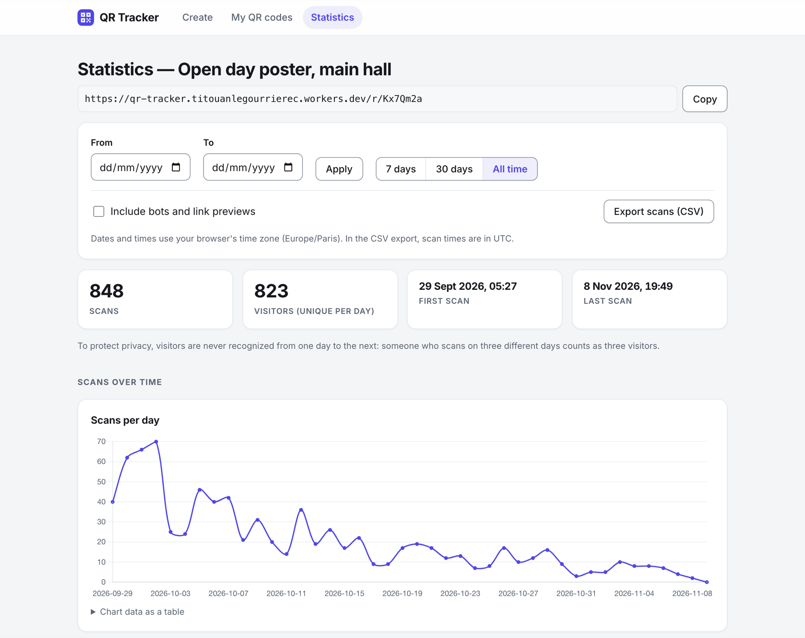
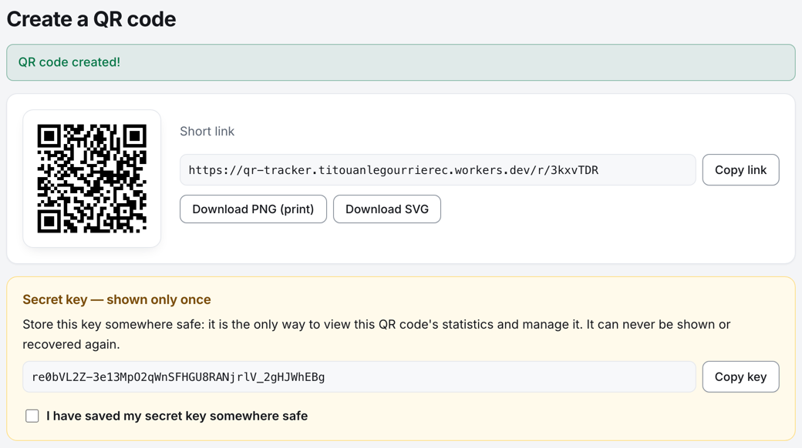
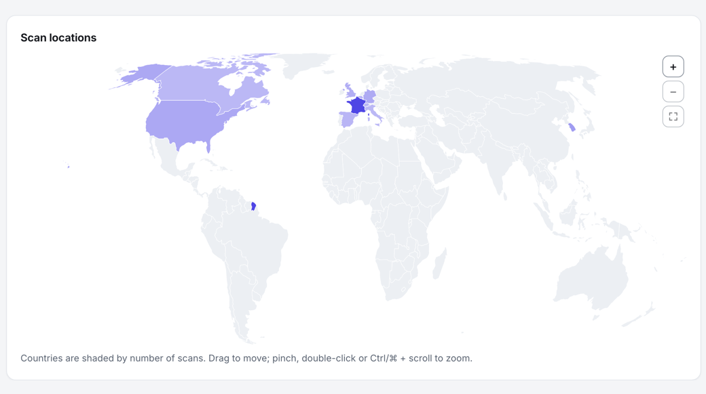
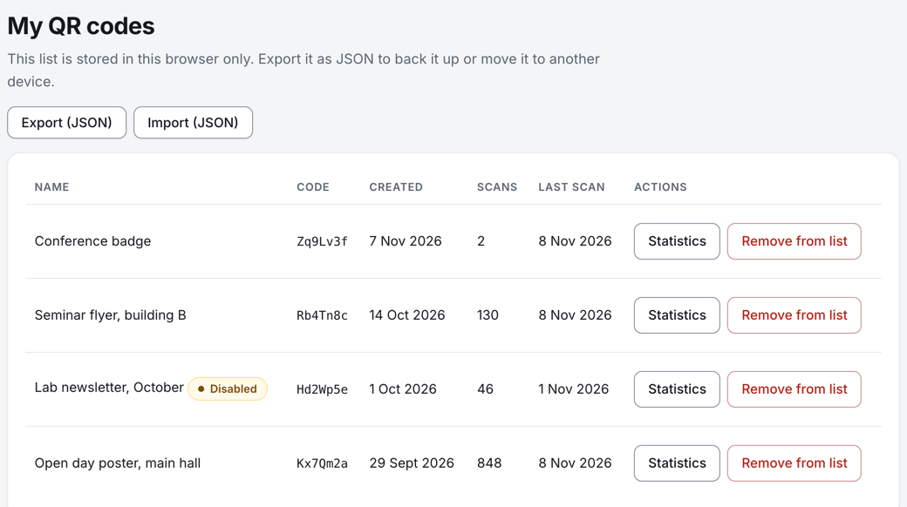

<p align="center">
  <picture>
    <source media="(prefers-color-scheme: dark)" srcset="docs/assets/qr-tracker-lockup-dark.svg">
    
  </picture>
</p>

<p align="center">
  <b>Make a QR code for any link and see where, when and on what it gets scanned,</b><br>
  with no account, no cookie and nothing that identifies the people who scan it.
</p>

<p align="center">
  <a href="https://titouanlegourrierec.github.io/qr-tracker/"><b>Open QR Tracker →</b></a>
</p>

<p align="center">
  <a href="https://github.com/titouanlegourrierec/qr-tracker/actions/workflows/deploy.yml"></a>
  <a href="https://github.com/titouanlegourrierec/qr-tracker/actions/workflows/monitor.yml"></a>
  <a href="https://github.com/titouanlegourrierec/qr-tracker/releases"></a>
  <a href="LICENSE"></a>
</p>



QR Tracker turns any web address into a QR code to print, and counts its scans
anonymously. There are no accounts: each code gets its own secret key, which opens its
statistics, changes its destination without reprinting, and can share a read-only view.
Every scan is redirected in milliseconds, without ever storing an IP address, a full
user-agent or a persistent identifier. Built for a research lab, open to anyone, and run on
free tiers only.

## Features

- **Create** a QR code for any public http(s) link, as a print-ready PNG or an SVG, behind
  a Cloudflare Turnstile check. The secret key, shown once, is its only credential.
- **Statistics**: scans and visitors over time, by hour and day of week, on a world map, and
  by country, city, device, operating system, browser and language. Date ranges in your
  time zone, bots and link previews left out, CSV export.
- **Manage without reprinting**: change the destination, disable and re-enable the code, or
  delete it with all its data.
- **Share read-only**: a second, revocable link opens the statistics but cannot change
  anything.
- **My QR codes**: the codes made in your browser with their scans and last scan, and a JSON
  export to move them elsewhere.
- **Anonymous by design**: coarse location, device families, language and a visitor hash
  whose salt is destroyed every day; scans are deleted after 12 months.
- **Abuse handling**: destinations checked against Google Safe Browsing, a public report
  form, and an operator kill switch.

<table>
  <tr>
    <td width="33%"></td>
    <td width="33%"></td>
    <td width="33%"></td>
  </tr>
  <tr>
    <td align="center">Create</td>
    <td align="center">Scan locations</td>
    <td align="center">My QR codes</td>
  </tr>
</table>

## How it works

A static React app on GitHub Pages creates the codes and shows the statistics. A Cloudflare
Worker (Hono + D1) on the free plan serves the short links: a scan of `…/r/<code>` gets its
302 at once, and the scan is recorded after the response, reduced to coarse facts before it
reaches the database. Keys are stored only as hashes and travel only in an `Authorization`
header and in the URL fragment, which browsers never send. A daily cron rotates the salt and
purges old data. [Architecture](docs/ARCHITECTURE.md) has the flows, the API and the data
model; the decision records explain the [key model](docs/adr/0002-secret-key-model.md) and
the [privacy model](docs/adr/0003-privacy-visitor-hashing.md).

## Run it yourself

```bash
git clone https://github.com/titouanlegourrierec/qr-tracker.git
cd qr-tracker
corepack enable   # Node 24; on Node >= 25: npm i -g pnpm
pnpm install
pnpm dev          # the web app on http://localhost:5173/qr-tracker/
```

Locally, Cloudflare's Turnstile test keys and a local D1 database stand in for the real
services: no account needed. [Development](docs/development.md) covers the commands and the
tests, and [Deployment and operations](docs/DEPLOYMENT.md) sets up your own copy on the free
tiers.

## Documentation

All of it is in [`docs/`](docs/README.md): the user guide, how it works, development,
deployment and operations, and the decision records.

## Contributing

Bug reports and ideas are welcome as
[issues](https://github.com/titouanlegourrierec/qr-tracker/issues);
[CONTRIBUTING.md](CONTRIBUTING.md) explains how to propose a change. Report a vulnerability
privately ([SECURITY.md](SECURITY.md)), and a harmful QR code through the app's
[Report abuse](https://titouanlegourrierec.github.io/qr-tracker/#/report) page.

## License

[MIT](LICENSE)
