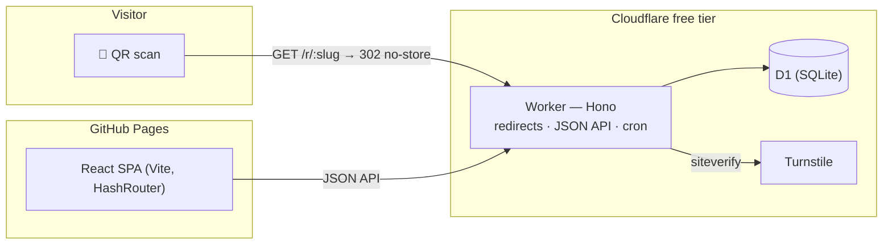

# QR Tracker

Free QR code generator with **anonymous scan analytics**. No accounts: each QR code gets
its own secret key. Built for a research lab, open to anyone.

- 🌐 Web app: <https://titouanlegourrierec.github.io/qr-tracker/>
- 📖 User guide: [docs/user-guide.md](docs/user-guide.md)

## What it does

- Generate a QR code for any URL (PNG print-ready + SVG), protected by Cloudflare
  Turnstile.
- Every scan is redirected in milliseconds (302, never cached) and recorded
  **anonymously**: country/region/city, timezone, ISP, device/OS/browser families,
  language, bot flag, and a daily-salted visitor hash. **No IPs, no full user-agents, no
  cookies, no persistent identifiers** (see the [privacy ADR](docs/adr/0003-privacy-visitor-hashing.md)).
- A private dashboard per QR code (secret key in the URL _fragment_ only): totals, time
  series, hour/day distributions, top locations & devices, bot toggle, CSV export.
- Manage without reprinting: change the destination, disable/enable, delete permanently.
- Abuse handling: public report form, Google Safe Browsing check on destinations, and an
  operator kill switch (`scripts/admin.mjs`).
- Free tiers only: GitHub Pages, Cloudflare Workers, D1, Turnstile.

## Architecture



Details: [docs/ARCHITECTURE.md](docs/ARCHITECTURE.md) · decisions: [docs/adr/](docs/adr/)
· original plan: [docs/PLAN.md](docs/PLAN.md).

## Tech stack

TypeScript strict everywhere · pnpm workspaces · **Worker**: Hono, D1 + Wrangler
migrations, Zod · **Web**: Vite 8, React 19, React Router (hash), Chart.js (lazy),
`qrcode` · **Shared**: Zod schemas as the single API contract · **Tests**: Vitest 4
(`@cloudflare/vitest-plugin` in the real Workers runtime, Testing Library + MSW, istanbul
coverage thresholds 90/90/80), Playwright E2E · ESLint 10 (type-checked) + Prettier ·
husky, lint-staged, commitlint · Dependabot.

## Local development

```bash
# Node 24 (.nvmrc) — Corepack ships with it:
corepack enable        # on Node >= 25 instead: npm i -g pnpm
pnpm install
pnpm dev               # worker http://localhost:8787 + web http://localhost:5173
```

Local D1 migrations are applied automatically, and `apps/worker/.dev.vars` is created
from the example with Cloudflare's Turnstile _test_ keys — creation works immediately.

## Scripts

| Command                                                      | Description                                                                 |
| ------------------------------------------------------------ | --------------------------------------------------------------------------- |
| `pnpm dev`                                                   | Worker + web app in parallel                                                |
| `pnpm check`                                                 | Format check, lint, typecheck, unit & integration tests (coverage enforced) |
| `pnpm test:e2e`                                              | Playwright end-to-end suite (real worker + built SPA)                       |
| `pnpm build`                                                 | Build all packages                                                          |
| `pnpm format` / `pnpm lint` / `pnpm typecheck` / `pnpm test` | Individual steps                                                            |
| `node scripts/admin.mjs disable <slug>`                      | Admin kill switch (needs `ADMIN_TOKEN`)                                     |

## Project structure

```
apps/worker/       Cloudflare Worker: routes → services → repositories, lib/ pure fns,
                   migrations/, tests in the real workerd runtime
apps/web/          React SPA, i18n/en.ts, components/, pages/, MSW tests
packages/shared/   Zod schemas + types + constants — the single API contract
e2e/               Playwright suite (create → scan → stats → edit → delete)
docs/              PLAN, ARCHITECTURE, DEPLOYMENT, ADRs, user guide
scripts/           admin.mjs (kill switch CLI)
```

## Documentation

- [docs/DEPLOYMENT.md](docs/DEPLOYMENT.md) — step-by-step deployment from scratch
- [docs/ARCHITECTURE.md](docs/ARCHITECTURE.md) & [docs/adr/](docs/adr/)
- [docs/user-guide.md](docs/user-guide.md) — user guide
- [CONTRIBUTING.md](CONTRIBUTING.md) · [CHANGELOG.md](CHANGELOG.md)

## License

[MIT](LICENSE)
