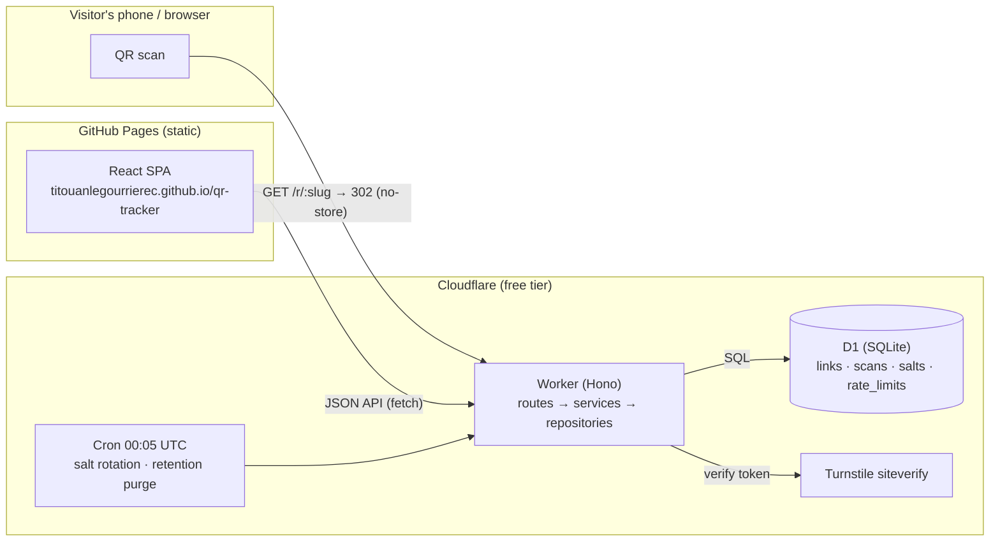

# Architecture

See [PLAN.md](PLAN.md) for the full design that was implemented, and [adr/](adr/) for the
key decision records.

## System overview

## Key flows

**Creation** — `POST /api/links`: Turnstile token verified server-side (fail-closed) →
target URL validated (http/https only, no credentials, no private hosts, not the worker
itself) → base62 slug + 256-bit key generated; only the key's SHA-256 is stored; the key
is returned exactly once. The destination is stored in its normalized form (`URL.href`):
a raw spelling such as `https:/host/path` passes validation, but a browser would resolve
it against the worker's own URL if it were sent verbatim in `Location`.

**Scan** — `GET /r/:slug`: 302 + `Cache-Control: no-store` responds immediately; the scan
is recorded inside `ctx.waitUntil()` (a tracking failure never breaks the redirect). Raw
IP and user-agent exist only in that function scope: they are reduced to a daily-salted
SHA-256 visitor hash and coarse device/OS/browser families before insert. Workers
invocation logs are disabled in `wrangler.jsonc` for the same reason (they would record
every request's headers). The 404/410/503 pages are `no-store` too (Chromium otherwise
caches a 410 indefinitely). If D1 fails, the redirect falls back to the last state the
isolate saw for that slug (bounded in-memory cache, `services/redirect.ts`).

**Abuse** — on creation and on every change of destination, the URL is checked against
Google Safe Browsing (Lookup API v4, fail-open, active only when `SAFE_BROWSING_API_KEY` is
set). `POST /api/reports` lets anyone report a link (Turnstile, rate limited by hashed IP,
no reporter identity stored); the operator lists and dismisses reports through
`/api/admin/reports` (`scripts/admin.mjs`), and a daily workflow fails while reports wait.

**Stats** — `GET /api/links/:slug/stats`: one atomic D1 batch of aggregate queries
(grouped by UTC hour/day over `idx_scans_link_time`), then the buckets are mapped to the
requested IANA timezone with Intl. Unique visitors are per-UTC-day by construction
(the salt rotates at UTC midnight).

**Kill switch** — the API exposes three statuses: `active`, `disabled` (owner) and
`blocked` (admin only). In D1 the owner's choice (`status`: active/disabled) and the
operator's block (`blocked_at`) are separate columns: a block never overwrites the owner's
choice, lifting it restores that choice, and owner updates run
`UPDATE … WHERE blocked_at IS NULL`, so a concurrent owner request cannot undo a block.

## Worker layering

- `routes/` — HTTP concerns only: parse/validate → call a service → shape the response.
- `services/` — business logic (links, scans, stats, cron).
- `repositories/` — the only modules that touch D1 (SQL lives here).
- `lib/` — pure functions (crypto, URL validation, UA parsing, bot detection, timezone
  bucketing, CSV, rate-limit math), each unit-tested.
- `middleware/` — CORS allowlist, security headers, D1-backed rate limiter
  (fail-closed on writes, fail-open on reads).

## Frontend

Vite + React SPA with **hash routing**: deep links work on GitHub Pages without redirect
hacks, and the secret key can live in the URL fragment (`#/stats/:slug/:key`) — the
fragment is never sent to any server. The API contract (Zod schemas in
`packages/shared`) validates every response. Chart.js is lazy-loaded on the stats route
only, and every chart has a `<table>` alternative (WCAG 2.1 AA).

## Known limitations

- Unique-visitor counts are per-UTC-day approximations (privacy trade-off, by design).
- Hour buckets are UTC hours: exact for whole-hour-offset timezones, up to 1h off at day
  boundaries for :30/:45 zones (e.g. Asia/Kolkata).
- The D1 rate limiter is exact but global (one counter row per key+window); at the free
  tier's traffic levels this is not a bottleneck.
- CSV export is capped at 50 000 rows per request.
