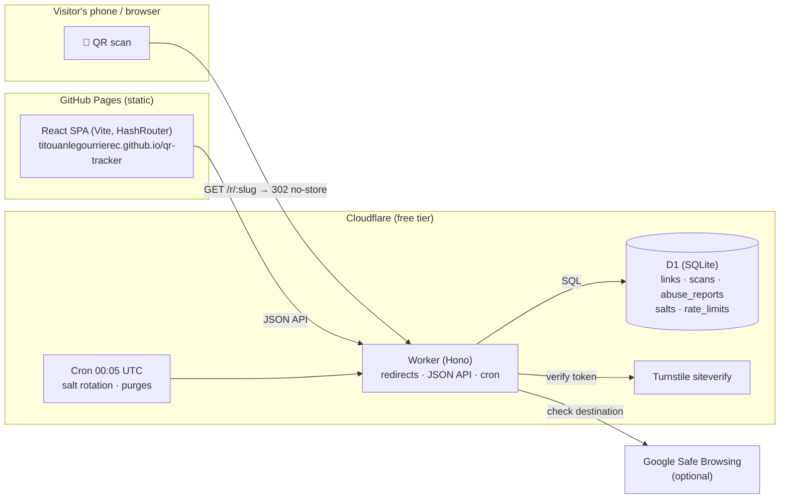

# Architecture

How QR Tracker works: the moving parts, the main flows, the API and the data. The key
decisions and their alternatives are recorded in [adr/](adr/); the code layout, tests and
tech stack are in [development.md](development.md).

## System overview

- **`apps/web`**: a static SPA on GitHub Pages under `/qr-tracker/`. No cookies, no
  analytics; it talks to the worker only through the JSON API.
- **`apps/worker`**: one Cloudflare Worker on `workers.dev` serving the redirects, the API
  and a daily cron, with D1 for storage.
- **`packages/shared`**: the Zod schemas, types, error codes and limits of every API body,
  imported by both apps. The worker validates every request with them and the SPA every
  response.

## Key flows

**Creation**: `POST /api/links`. The Turnstile token is verified server-side (fail-closed).
The destination must be http(s), at most 2,048 characters, without credentials, not a
private, loopback or `.local` host, and not the worker itself; it is stored normalized
(`URL.href`), because a raw spelling such as `https:/host/path` passes validation but would
resolve against the worker's own URL in `Location`. The worker generates a 7-character
base62 slug and a 256-bit key, stores only the key's SHA-256, and returns the key once.

**Scan**: `GET /r/:slug` answers 302 with `Cache-Control: no-store` at once and records the
scan in `ctx.waitUntil()`, so a tracking failure never breaks the redirect. The raw IP and
user-agent exist only in that function: they become a daily-salted SHA-256 visitor hash and
coarse device, OS and browser families before the insert. For the same reason Workers
invocation logs are off (`wrangler.jsonc`): they would record every request's headers. The
404/410/503 pages are `no-store` too (Chromium otherwise caches a 410 indefinitely). If D1
fails, the redirect falls back to the last state the isolate saw for the slug (a bounded
in-memory cache, `services/redirect.ts`); unknown slugs then get a 503 with `Retry-After`.

**Stats**: `GET /api/links/:slug/stats` runs one atomic D1 batch of aggregates grouped by
UTC hour and day (over `idx_scans_link_time`), then maps the buckets to the requested IANA
timezone with `Intl`. Unique visitors are per UTC day by construction (the salt rotates at
UTC midnight), hence the label "Visitors (unique per day)". The export reads `from`/`to` in
the same `tz`, so a CSV covers the dashboard's days; its rows keep UTC timestamps.
`POST /api/links/summaries` serves "My QR codes": up to 50 `{slug, secretKey}` pairs in the
body (never in a URL), each checked against its own hash, answered from one grouped query
for one rate-limit hit.

**Read-only sharing**: the owner can create a second key (`POST /api/links/:slug/view-key`,
returned once, stored as `links.view_hash`, revoked by `DELETE`). `authorizeLinkRead`
accepts either key for the link, its stats, its export and the summaries, and reports the
`access` (`owner` / `viewer`); `authorizeLink` (updates, deletion, the key endpoints)
accepts the secret key only. The SPA uses the same `#/stats/:slug/:key` route and hides the
management panel from viewers.

**Abuse**: on creation and on every change of destination, the URL is checked against
Google Safe Browsing (Lookup API v4, 3 s timeout, fail-open, only once
`SAFE_BROWSING_API_KEY` is set). Anyone can report a link (`POST /api/reports`, Turnstile,
no reporter identity stored); the operator triages through `/api/admin/*` with
`scripts/admin.mjs`, and a daily workflow fails while reports wait
([ADR 0004](adr/0004-abuse-handling.md), [operations](DEPLOYMENT.md#11-abuse-handling)).

**Kill switch**: the API exposes three statuses: `active`, `disabled` (owner) and `blocked`
(operator only); the redirect serves 410 for both non-active ones. In D1 the owner's choice
(`status`: active/disabled) and the operator's block (`blocked_at`) are separate columns: a
block never overwrites the owner's choice, lifting it restores that choice, and owner
updates run `UPDATE … WHERE blocked_at IS NULL`, so a concurrent owner request cannot undo a
block.

**Cron** (daily, 00:05 UTC): deletes the salt of the day that just ended, purges scans and
reports older than `RETENTION_DAYS` (365), and cleans expired rate-limit windows.

## API

Every body is validated with the `packages/shared` schemas after a 32 KiB size cap. Errors
are `{ "error": { "code", "message" } }`, with `code` one of `VALIDATION_ERROR`,
`TARGET_URL_INVALID`, `TURNSTILE_FAILED`, `UNAUTHORIZED`, `FORBIDDEN`, `NOT_FOUND`,
`RATE_LIMITED`, `PAYLOAD_TOO_LARGE` or `INTERNAL`. Keys travel only in
`Authorization: Bearer <key>` (or in the summaries body), never in a URL.

| Endpoint                                             | Auth             | Purpose                                          |
| ---------------------------------------------------- | ---------------- | ------------------------------------------------ |
| `GET /r/:slug`                                       | none             | 302 to the destination, scan recorded            |
| `POST /api/links`                                    | Turnstile        | Create a link; returns slug, short URL, key      |
| `POST /api/links/summaries`                          | keys in the body | "My QR codes": status, scans, last scan          |
| `GET /api/links/:slug`                               | either key       | Link metadata and `access`                       |
| `GET /api/links/:slug/stats?from&to&tz&includeBots`  | either key       | Aggregated statistics                            |
| `GET /api/links/:slug/export?from&to&tz&includeBots` | either key       | CSV of anonymous scan rows (≤ 50,000)            |
| `PATCH /api/links/:slug`                             | secret key       | Change destination and/or `active`/`disabled`    |
| `DELETE /api/links/:slug`                            | secret key       | Delete the link and all its data                 |
| `POST` / `DELETE /api/links/:slug/view-key`          | secret key       | Create or replace / revoke the read-only key     |
| `POST /api/reports`                                  | Turnstile        | Report a link (reason, optional details)         |
| `POST /api/admin/links/:slug/status`                 | `ADMIN_TOKEN`    | Kill switch: `{ status: "active" \| "blocked" }` |
| `GET /api/admin/reports`                             | `ADMIN_TOKEN`    | Waiting reports, grouped by link                 |
| `DELETE /api/admin/links/:slug/reports`              | `ADMIN_TOKEN`    | Dismiss a link's reports                         |
| `GET /api/health`                                    | none             | Liveness                                         |
| `GET /`, `GET /report`                               | none             | Redirect to the web app (its report page)        |

- **Stats**: totals (scans, unique visitors, first/last scan), scans per day and per hour
  (the hour series only for ranges up to 14 days), hour-of-day and day-of-week
  distributions, and the top 10 countries, cities (per country), devices, OSes, browsers
  and languages. `tz` defaults to `Europe/Paris`; `includeBots` to `false`; dates must lie
  in 2000-01-01…2099-12-31 and the day series is clamped to 366 days.
- **Rate limits** (fixed windows in D1, keyed by a daily-salted IP hash; `RATE_LIMIT_MULTIPLIER`
  scales them): creation 10/hour, reports 5/hour, everything behind a key 60/minute per
  IP and slug (the summaries per IP). If D1 fails, requests that change data are refused
  and reads (summaries included) go through.
- **CORS** allows `ALLOWED_ORIGINS`: the GitHub Pages origin in production; the local
  origins come from `.dev.vars`, which is never deployed.

## Data model

SQL migrations live in [`apps/worker/migrations/`](../apps/worker/migrations/) and are
forward-only. Timestamps are ISO-8601 UTC strings, booleans `INTEGER` 0/1.

| Table           | Holds                                                                                                                                                           |
| --------------- | --------------------------------------------------------------------------------------------------------------------------------------------------------------- |
| `links`         | `slug`, normalized `target_url`, `label`, `secret_hash` and optional `view_hash` (SHA-256), owner `status` (active/disabled), operator `blocked_at`, timestamps |
| `scans`         | `scanned_at`, country, region, city, timezone (from `request.cf`), device type, OS and browser families, primary language, `is_bot`, `visitor_hash`             |
| `abuse_reports` | Link, reason (phishing, malware, spam, illegal, other), optional details (≤ 1,000 characters), date                                                             |
| `salts`         | One random salt per UTC day, created lazily (`INSERT OR IGNORE`), deleted by the cron                                                                           |
| `rate_limits`   | Counter per key and window start                                                                                                                                |

`scans` and `abuse_reports` cascade with their link; deletion also runs as an explicit
atomic batch. Never stored or logged: a raw IP, a full user-agent, any persistent
identifier ([ADR 0003](adr/0003-privacy-visitor-hashing.md)).

## Worker layering

- `routes/`: HTTP only: parse and validate → call a service → shape the response.
- `services/`: business logic (links, scans, stats, reports, redirect, cron).
- `repositories/`: the only modules that touch D1 (all SQL lives here).
- `lib/`: pure, unit-tested functions: crypto, URL reputation, user-agent parsing, bot
  detection, visitor hash, language, timezone bucketing, CSV, rate-limit math, body limits.
- `middleware/`: security headers, CORS allowlist, request body cap, then the D1-backed
  rate limiter per route, in that order on `/api/*`.

The body cap (`lib/body-limit.ts`) is 32 KiB: the largest valid request (a new link with
every field at its maximum, ≈ 18.8 KB of JSON) rounded up to a power of two, derived from
the shared schema limits. Larger bodies get 413 `PAYLOAD_TOO_LARGE` before `JSON.parse` or
Zod: a declared `Content-Length` is refused from the header alone, before the rate limiter
spends a D1 write; a body without one is read up to the cap at most.

## Web app

A Vite + React SPA with **hash routing**: deep links work on GitHub Pages without redirect
hacks, and the key lives in the URL fragment (`#/stats/:slug/:key`), which browsers never
send to a server. Routes: `#/` (create), `#/codes` (My QR codes, kept in `localStorage`
with JSON export/import), `#/stats` (paste a private link or enter slug and key),
`#/stats/:slug/:key` (dashboard and management), `#/privacy`, `#/legal`, `#/report`.

Every API response is validated with the shared schemas. Chart.js and the world map (SVG
drawn with d3-geo + topojson-client from world-atlas) are lazy-loaded on the stats route
only, and every chart has a `<table>` alternative (WCAG 2.1 AA). QR codes are generated in
the browser (`qrcode`): SVG and a 1024 px PNG. GitHub Pages cannot send headers, so the CSP
is a `<meta>` tag.

## Known limitations

- Unique-visitor counts are per-UTC-day approximations (privacy trade-off, by design).
- Hour buckets are UTC hours: exact for whole-hour offsets, up to 1 h off at day
  boundaries for :30/:45 zones (e.g. Asia/Kolkata).
- The D1 rate limiter is exact but global (one counter row per key and window); at the free
  tier's traffic this is not a bottleneck.
- The CSV export stops at 50,000 rows per request.
- GitHub Pages cannot send `frame-ancestors`/`X-Frame-Options`: against clickjacking, the
  SPA refuses to render inside a frame (`lib/framing.ts`) and links to itself instead. A
  real header needs other hosting (e.g. Cloudflare Pages with `_headers`).
- The private-host filter reads the URL only: a public name that resolves to a private
  address (e.g. `127.0.0.1.nip.io`) passes. Harmless here, since the worker never fetches
  destinations, it only redirects browsers.
- On the free plan every quota is a hard daily cutoff; nothing inside the worker can stop a
  flood ([DEPLOYMENT.md §10](DEPLOYMENT.md#10-protecting-the-redirect-from-floods)).
